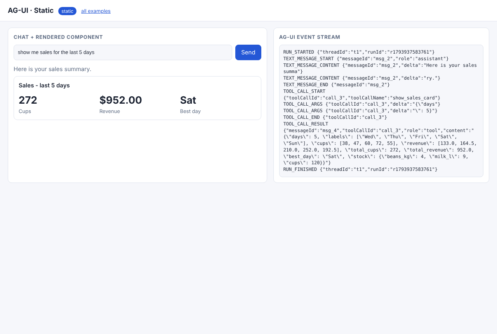
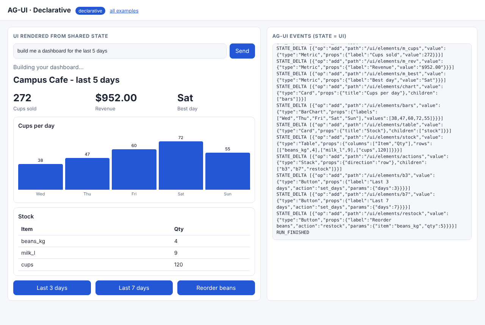
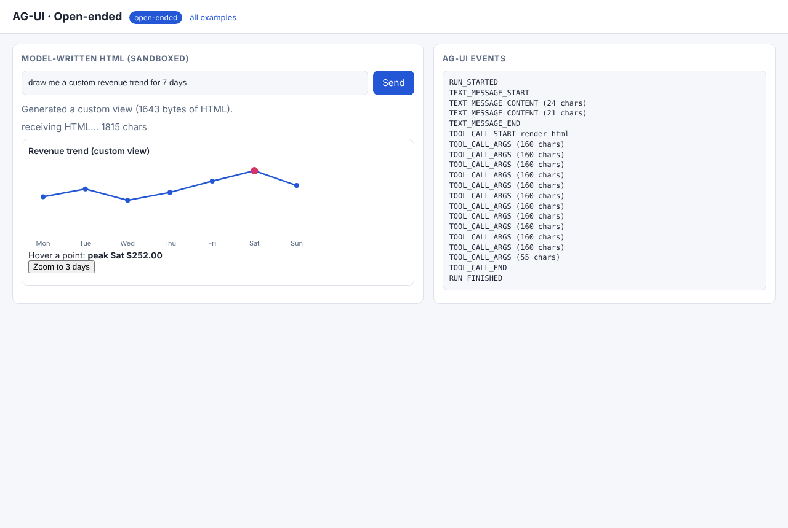
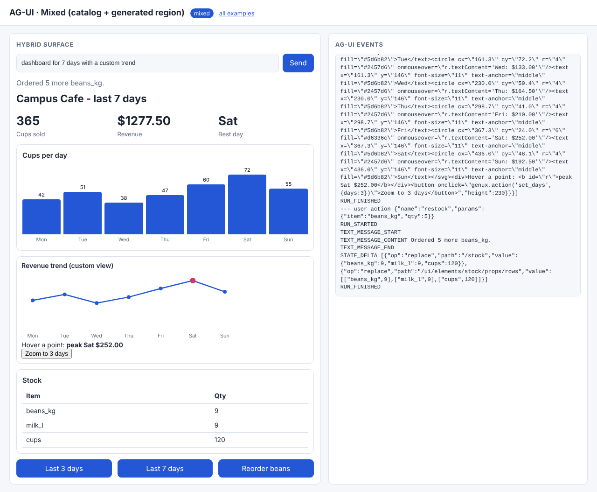

# 01 · AG-UI: the agent ↔ page event stream

**AG-UI (Agent-User Interaction Protocol) is a transport, not a UI format.** A run is a stream of typed JSON
events from the agent to the frontend: `RUN_STARTED`, `TEXT_MESSAGE_*`, `TOOL_CALL_*`, `STATE_SNAPSHOT`,
`STATE_DELTA`, `CUSTOM`, `RUN_FINISHED` / `RUN_ERROR`. The frontend starts a run by POSTing a `RunAgentInput`
`{threadId, runId, messages, tools, state, forwardedProps}`. Here the events travel over SSE.
Spec: <https://docs.ag-ui.com/concepts/events>.

Shared code: [`common/agui.py`](../common/agui.py) (event constructors, terminal printer),
[`common/web/sse.js`](../common/web/sse.js) (POST + SSE reader), [`common/web/jsonpatch.js`](../common/web/jsonpatch.js).

| Mode | Folder | What the model produces | How AG-UI carries it |
|---|---|---|---|
| static | [01_static](01_static/) | a tool choice + args | `TOOL_CALL_START/ARGS/END/RESULT` → the page maps the tool name to a prebuilt component |
| declarative | [02_declarative](02_declarative/) | a flat catalog spec | `STATE_SNAPSHOT` + one `STATE_DELTA` (JSON Patch) per element → progressive render |
| open-ended | [03_open_ended](03_open_ended/) | raw HTML | streamed as `render_html` tool-call args → sandboxed iframe |
| mixed | [04_mixed](04_mixed/) | catalog spec + one `GeneratedView` | state deltas, and clicks start new runs via `forwardedProps.action` |

## Run it

```bash
python 01_ag_ui/01_static/example.py      # terminal trace of the event stream (works for every mode)
python serve.py                           # then open http://127.0.0.1:8000/01_ag_ui/01_static/
```

## Code walkthrough

### 01 · static: the model selects, the frontend draws
1. `example.py` → `TOOLS`: the only three UIs that exist (`show_sales_card`, `show_sales_chart`, `show_stock_table`).
   `SYSTEM` lists them and asks the model for `{"say", "tool", "args"}`.
2. `scripted()` is the offline stand-in for the model. With `GENUX_LIVE=1`, `common/llm.complete()` sends the same prompt to Claude.
3. `run()` is the agent as a **generator of events**. It rejects any tool that the frontend didn't ship,
   streams the sentence as `TEXT_MESSAGE_CONTENT`, then streams the arguments as `TOOL_CALL_ARGS` chunks (`agui.tool_call`).
4. `index.html` → `FRONTEND_TOOLS`: hand-written components keyed by tool name. The `switch` in the reader
   accumulates `TOOL_CALL_ARGS` and draws on `TOOL_CALL_RESULT`.
5. **Takeaway:** safest and cheapest mode. The model can't produce a layout you didn't build.

### 02 · declarative: the UI *is* shared state
1. The `SYSTEM` prompt is generated from the catalog (`common/catalog.py → catalog_prompt()`).
2. `run()` validates the whole spec (`validate_flat`) **before** anything is sent, then emits
   `STATE_SNAPSHOT {"ui": {root, elements: {}}}` and one `STATE_DELTA [{"op":"add","path":"/ui/elements/<id>"}]` per element.
3. `index.html` applies each patch (`applyPatch`) and re-renders with `flatToTree` + `renderNode`. Missing children
   render as placeholders, so the page fills in while the stream is still arriving.
4. **Takeaway:** a flat element map streams well. Each element is independently valid, and JSON Patch keeps updates small.

### 03 · open-ended: freedom costs bytes and trust
1. The model writes an HTML fragment. `common/sandbox.check_html()` rejects external scripts, network APIs,
   storage and top-level navigation **on the server**.
2. The HTML travels as `TOOL_CALL_ARGS` of `render_html` (about 1.8 KB vs about 1 KB for the whole declarative dashboard).
3. `common/web/sandbox.js → mountSandboxed()`: `sandbox="allow-scripts"` (no `allow-same-origin` → opaque origin),
   a CSP `default-src 'none'`, and one allowed message shape `{type:"genux:action"}`. Only `set_days` is honoured.
4. **Takeaway:** a sandbox reduces capability. It doesn't make output trustworthy, so keep the server-side checks too.

### 04 · mixed: catalog + one escape hatch + closed loop
1. `dashboard_spec(days, hybrid=True)` adds a `GeneratedView` element. It is validated by the catalog **and** the HTML policy.
2. A click (catalog `Button` or `genux.action()` inside the iframe) calls `act()` in `index.html`, which starts a **new run**
   with `forwardedProps: {action: {name, params}}` and the current `state`.
3. `handle_action()` checks `ALLOWED_ACTIONS` and answers with **`replace` patches only**: the title, metrics, chart and the
   generated region for `set_days`, the stock rows for `restock`. `agui.guarded()` guarantees a run ends with exactly one of
   `RUN_ERROR` / `RUN_FINISHED`.
4. `render()` keeps the existing iframe when its HTML didn't change, so a stock update doesn't reload the custom view.

Recorded output: [docs/EXECUTION_LOG.md#01_ag_ui](../docs/EXECUTION_LOG.md#01_ag_ui).

| static | declarative | open-ended | mixed (after "Reorder beans") |
|---|---|---|---|
|  |  |  |  |
