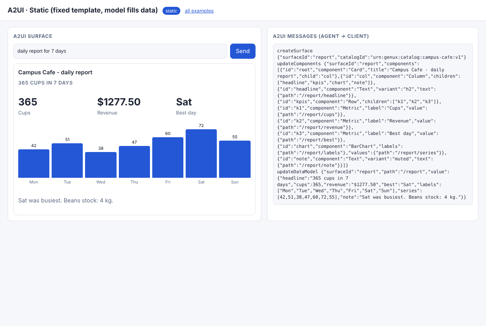
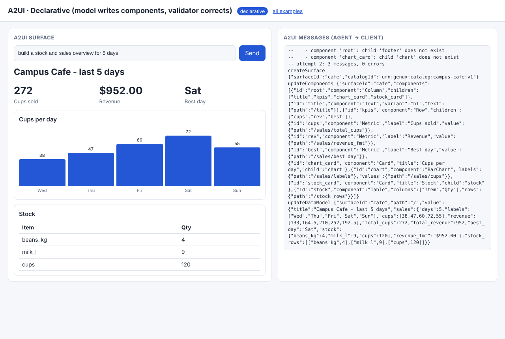
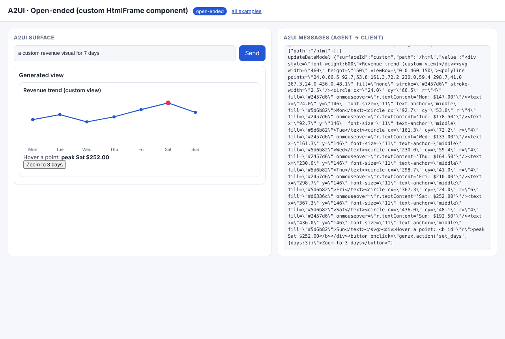
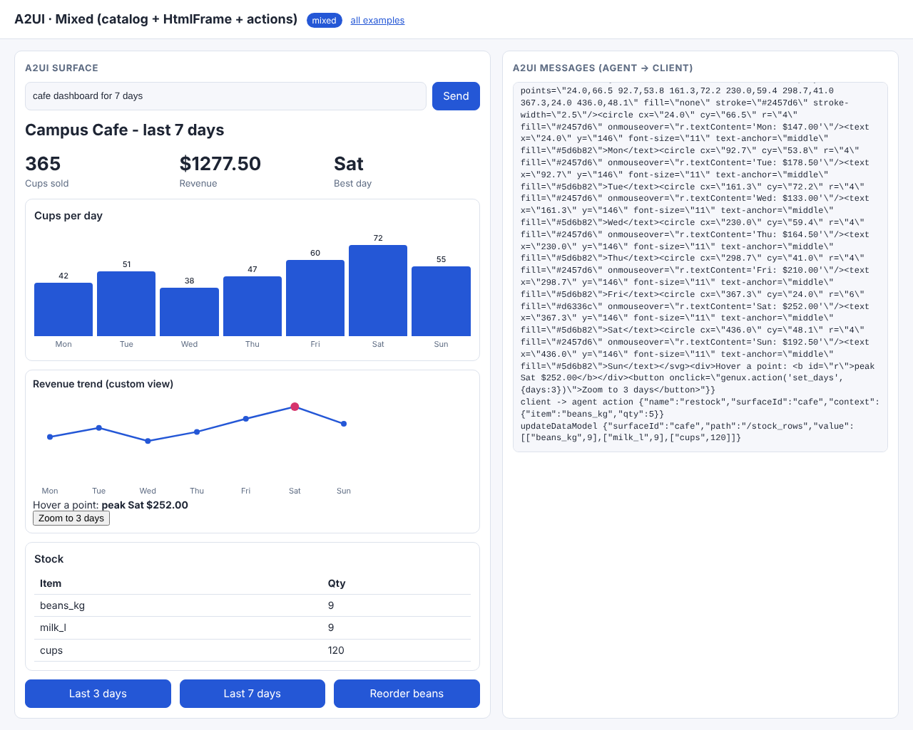

# 02 · A2UI: structure and data as two streams

**A2UI (Agent-to-UI) is a declarative UI *format*.** An agent sends messages that a client renders with its
**own** components. It never ships code. We follow the v0.9 message shapes (<https://a2ui.org/>):

| message | purpose |
|---|---|
| `createSurface {surfaceId, catalogId}` | open a surface and name the component catalog |
| `updateComponents {surfaceId, components:[…]}` | flat list, each `{id, component, …props}`; children referenced by id (`child` / `children`) |
| `updateDataModel {surfaceId, path, value}` | JSON data; any prop may be a binding `{"path": "/sales/total"}` |
| `deleteSurface {surfaceId}` | tear down |
| client → agent `{action: {name, surfaceId, context}}` | a user interaction |

Shared code: [`common/a2ui.py`](../common/a2ui.py) (messages, `validate()`, `Surface` + terminal renderer) and
[`common/web/a2ui.js`](../common/web/a2ui.js) (browser surface: applies messages, resolves bindings, maps A2UI components onto the catalog renderer).
Our catalog `urn:genux:catalog:campus-cafe:v1` is the basic catalog (Column, Row, Card, Text, Button, Divider) plus `Metric`, `BarChart`, `Table`.

| Mode | Folder | Who decides structure | Who decides data |
|---|---|---|---|
| static | [01_static](01_static/) | developer (`template.json`) | model (`updateDataModel` only) |
| declarative | [02_declarative](02_declarative/) | model (validated, self-corrected) | model |
| open-ended | [03_open_ended](03_open_ended/) | model HTML inside an **opt-in** `HtmlFrame` component | model |
| mixed | [04_mixed](04_mixed/) | model (catalog + `HtmlFrame` + Buttons) | actions → `updateDataModel` only |

```bash
python 02_a2ui/02_declarative/example.py   # shows the correction loop
python serve.py                            # http://127.0.0.1:8000/02_a2ui/01_static/
```

## Code walkthrough

### 01 · static: a fixed template, the model fills the data model
- `template.json` holds nine components whose props are bindings (`"value": {"path": "/report/cups"}`).
- `messages_for()` always sends the same `createSurface` + `updateComponents`. The model's JSON is type-checked
  (`check_data`) and becomes a single `updateDataModel` at `/report`.
- The CLI renders the same messages with `Surface.text_render()`: one format, two clients.
- Test `test_static_structure_is_fixed` proves the components are identical for every prompt and only the data differs.

### 02 · declarative: validation errors are results
- `SYSTEM` is built from `a2ui.catalog_prompt()`. The model writes JSONL, one message per line (`parse_jsonl`).
- `a2ui.validate()` checks version, message order, catalog membership, required/unknown props, the `root` id and dangling child ids.
- `generate()` loop: on errors, the **errors themselves become the next prompt** ("VALIDATION ERRORS in your previous reply…").
  The scripted model's first attempt uses a `PieChart` and an undefined `footer`. Attempt 2 is valid. Only valid messages reach the client.

### 03 · open-ended: HTML needs an explicit opt-in
- A2UI carries data, not code. To allow HTML, the client must advertise `urn:genux:catalog:campus-cafe-html:v1`, which contains `HtmlFrame`.
- The HTML goes in the **data model** (`/html`) and is bound to `HtmlFrame.html`. The browser maps `HtmlFrame` → `GeneratedView` → sandboxed iframe.
- The CLI validates the same messages against the plain catalog and they are rejected. The catalog is the security boundary.

### 04 · mixed: actions update data, never structure
- `a2ui_dashboard(days, html=True, actions=True)` adds an `HtmlFrame` and three Buttons with `action: {name, context}`.
- `on_action()` allow-lists `set_days` / `restock` and replies with `updateDataModel` messages only (`/stock_rows`, `/title`, `/sales`, `/custom_html`).
  Zero components are resent, so structure and data really are separate streams.

Recorded output: [docs/EXECUTION_LOG.md#02_a2ui](../docs/EXECUTION_LOG.md#02_a2ui).

| static | declarative | open-ended | mixed (after action) |
|---|---|---|---|
|  |  |  |  |
