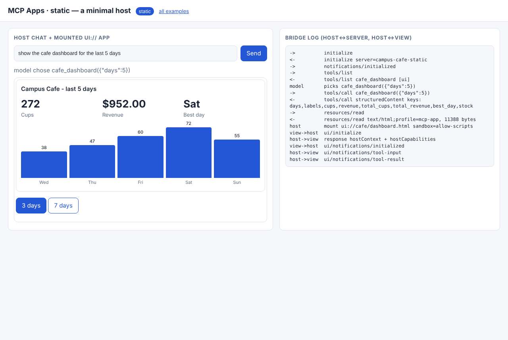
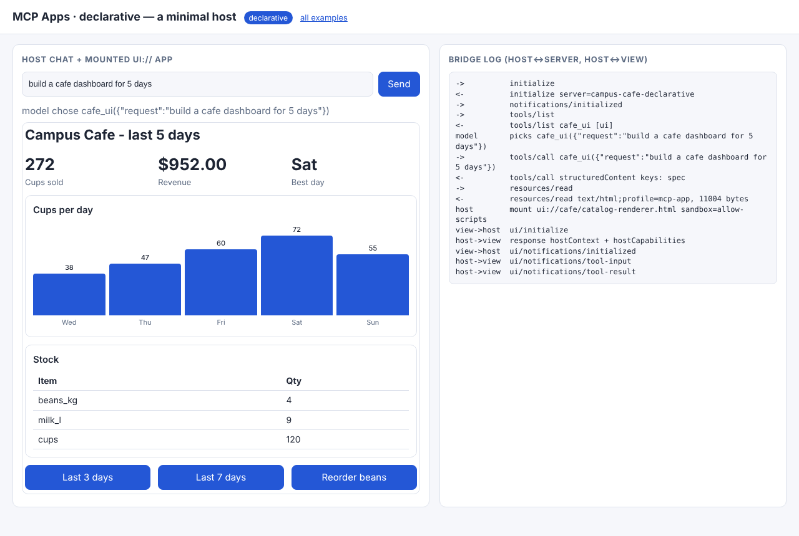
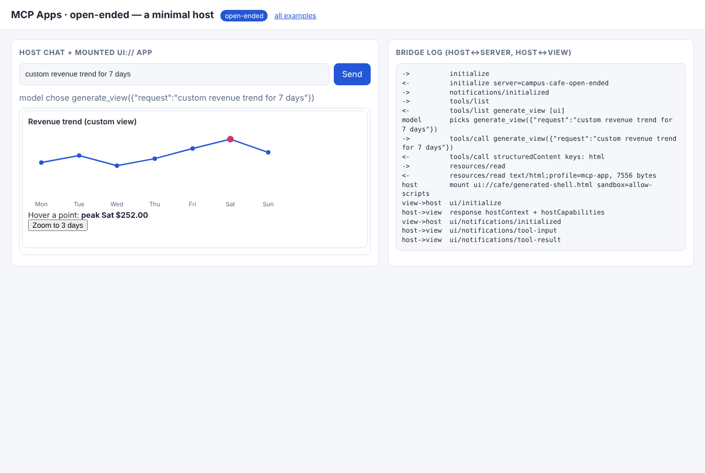
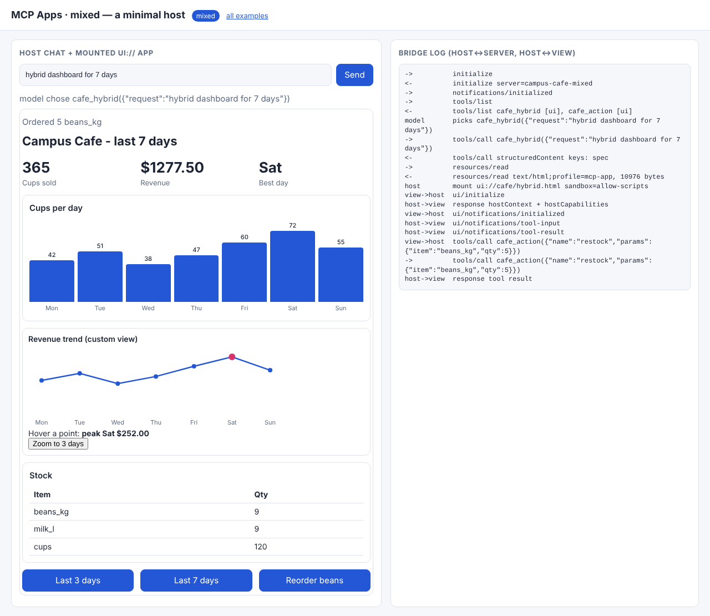

# 03 · MCP Apps: a tool result that carries its own interface

**MCP Apps (SEP-1865)** extends the Model Context Protocol so a tool can come with UI
(<https://modelcontextprotocol.io/extensions/apps/overview>):

1. The tool declares `_meta.ui.resourceUri = "ui://…"`.
2. `resources/read` of that URI returns HTML with `mimeType: "text/html;profile=mcp-app"`.
3. The **host** (Claude Desktop, Goose, or our minimal host) mounts it in a sandboxed iframe and runs a postMessage JSON-RPC bridge:
   `ui/initialize` → `ui/notifications/initialized` → `ui/notifications/tool-input` / `tool-result`; the view may send
   `tools/call` (the host decides whether to forward it) and `ui/notifications/size-changed`.

No SDK on either side, so every message is visible:

| file | role |
|---|---|
| [`common/mcp.py`](../common/mcp.py) | `MCPServer` (JSON-RPC over stdio: initialize, tools/list|call, resources/list|read), `MCPClient`, `view_page()` (CSP + inlined bridge) |
| [`common/web/mcp_view_bridge.js`](../common/web/mcp_view_bridge.js) | view side of the bridge (`mcp.connect()`, `mcp.callTool()`, `mcp.on()`) |
| [`common/web/mcp_host.js`](../common/web/mcp_host.js) | host side: MCP client + iframe mount + bridge + **tool allow-listing** |
| [`common/mcp_host.py`](../common/mcp_host.py) | the local host process: spawns `server.py`, forwards JSON-RPC, owns the model call that picks a tool |
| `<mode>/server.py` | the MCP server (also runnable on its own: `python server.py --stdio`) |
| `<mode>/example.py` | host routes + terminal trace |

| Mode | Tool returns (`structuredContent`) | The `ui://` view |
|---|---|---|
| [static](01_static/) | sales data | hand-written dashboard; its buttons call the tool back through the host |
| [declarative](02_declarative/) | a catalog spec written by the model **on the server** | a generic catalog renderer (no layout of its own) |
| [open-ended](03_open_ended/) | model-written HTML | a shell that nests the HTML in a **second** sandbox (host → view → content) |
| [mixed](04_mixed/) | catalog spec + `GeneratedView` | renderer; actions go through an **app-only** tool `cafe_action` (`visibility: ["app"]`, hidden from the model) |

```bash
python 03_mcp_apps/01_static/example.py    # host <-> server trace over real stdio
python serve.py                            # http://127.0.0.1:8000/03_mcp_apps/01_static/  (bridge log on the right)
```

Using a server from a desktop host: point its MCP config at `python /path/to/03_mcp_apps/01_static/server.py --stdio`.

## Code walkthrough

### 01 · static
- `server.py`: `server.tool("cafe_dashboard", …, resource_uri=URI)` puts `_meta.ui.resourceUri` on the tool. `cafe_dashboard()` returns
  data. `_text` becomes `content[0].text` (what the **model** reads), and the rest becomes `structuredContent` (what the **view** reads).
- `VIEW_SCRIPT`: `mcp.on("ui/notifications/tool-result", …)` draws. The buttons call `mcp.callTool("cafe_dashboard", {days})`, which goes view → host → server.
- `view_page()` inlines the bridge and the renderer modules: a `srcdoc` iframe with `default-src 'none'` can't fetch scripts.
  (`inline_modules` escapes `</script` so inlined code can't close the tag early. A test enforces this.)
- `mcp_host.js → mount()`: answers `ui/initialize` with `hostContext` (theme, display mode), then delivers `tool-input` and `tool-result`.

### 02 · declarative
- The **server** calls the model (`cafe_ui()`), validates the spec, and returns it. The view is reusable for any spec, so new screens need no new view code.

### 03 · open-ended
- `generate_view()` runs the HTML policy. The view calls `mountSandboxed()` to create a nested iframe: the generated code is two origins away from the host page.

### 04 · mixed
- `cafe_action` is registered with `visibility=["app"]`. `mcp_host.py → chat()` filters such tools out of the model's tool list,
  while `mcp_host.js` lets the view call them. Server state (`STOCK`) lives in the server, not in the iframe.
- Unknown actions raise in `cafe_action()`, and the error is returned to the view as a JSON-RPC error.

Recorded output: [docs/EXECUTION_LOG.md#03_mcp_apps](../docs/EXECUTION_LOG.md#03_mcp_apps).

| static | declarative | open-ended | mixed (after action) |
|---|---|---|---|
|  |  |  |  |
