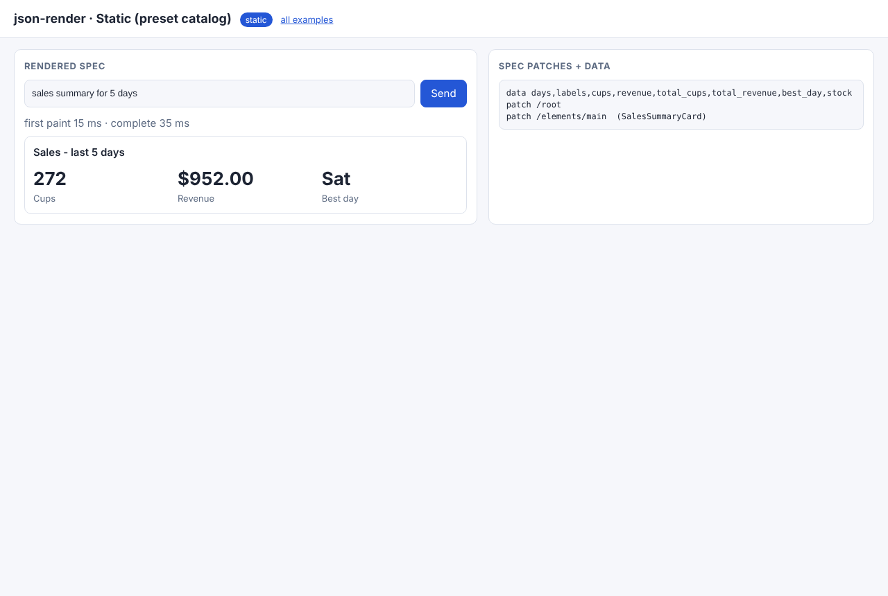
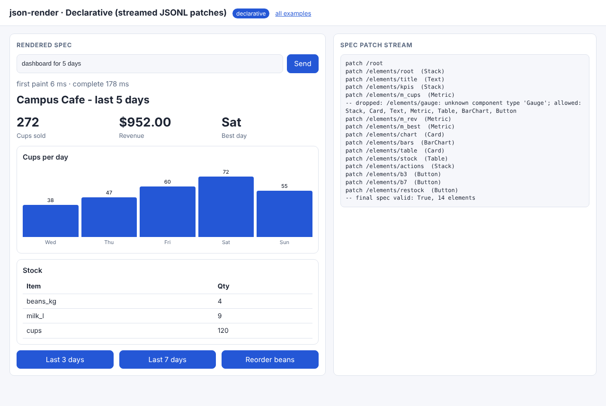
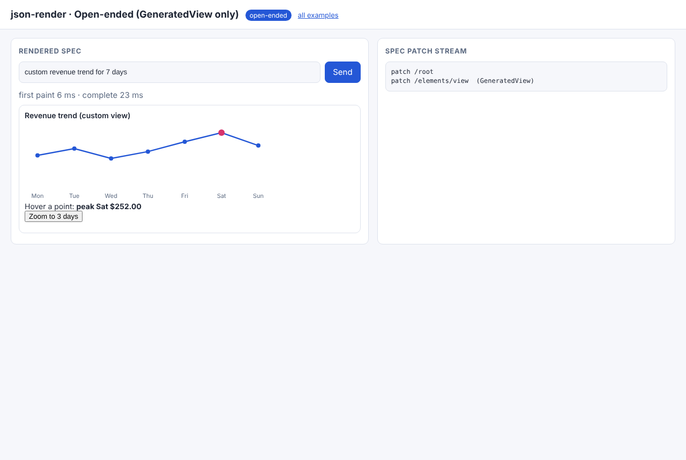
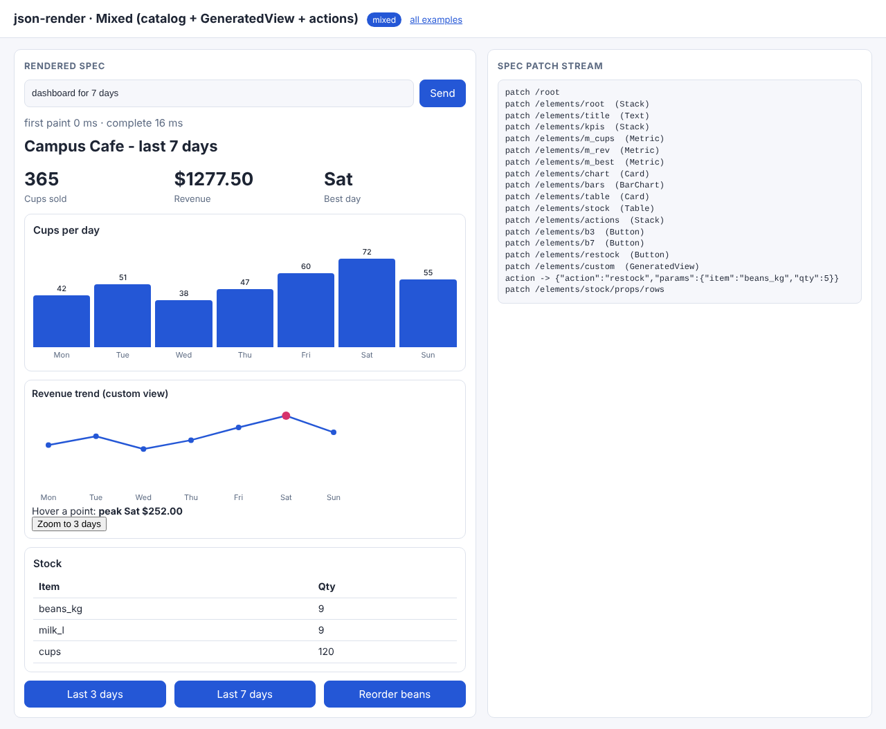

# 04 · json-render: one catalog, streamed patches, several renderers

Modeled on [vercel-labs/json-render](https://github.com/vercel-labs/json-render) and reimplemented in about 150 lines
([`common/jsonrender.py`](../common/jsonrender.py)) so every step is visible:

* **The catalog is three things at once:** the system prompt (`catalog_prompt()`), the validator (`validate_spec()`, `validate_action()`)
  and the renderer registry (`common/web/catalog.js`). It lists **actions with typed params** as well as components.
* **The spec is a flat element map** `{"root": id, "elements": {id: {type, props, children}}}`.
* **Models stream it as JSONL RFC 6902 patches** (`/root`, then `/elements/<id>`), so each finished line can be painted at once.
* **One spec, many targets:** the browser renderer and `terminal_render()`.

| Mode | Folder | Catalog given to the model |
|---|---|---|
| static | [01_static](01_static/) | `PRESETS` only (SalesSummaryCard, DailyCupsChart, StockTable); exactly one element allowed |
| declarative | [02_declarative](02_declarative/) | primitives; streamed patches parsed incrementally (`PatchStreamParser`) |
| open-ended | [03_open_ended](03_open_ended/) | a single `GeneratedView {html}`; the terminal target can't render it |
| mixed | [04_mixed](04_mixed/) | primitives + `GeneratedView` + typed actions; browser **and** terminal |

```bash
python 04_json_render/02_declarative/example.py   # watch patches arrive, a bad element get dropped
python 04_json_render/04_mixed/example.py         # the same spec in the terminal, then an action
python serve.py                                   # http://127.0.0.1:8000/04_json_render/02_declarative/
```

## Code walkthrough

### 01 · static
- `generate()` refuses any spec that isn't exactly one preset element (the CLI shows a rejected `Stack` layout).
- `stream()` sends the preset's data on a side channel (`{"data": …}`). `index.html → PRESETS` are the developer-written components.

### 02 · declarative
- `scripted()` emits real JSONL patches and hallucinates a `Gauge` mid-stream.
- `stream()` feeds the model text **in chunks** to `PatchStreamParser.feed()`. Each completed line is validated: valid → forwarded
  as `{"patch": op}`; invalid → dropped with a note, and the stream continues.
- `page.js` applies each patch and re-renders, and shows **first paint vs complete** time in the page.

### 03 · open-ended
- One `GeneratedView`. `terminal_render()` can only print a placeholder: open-ended output is the least portable choice.

### 04 · mixed
- Buttons' `action` / `params` are validated against `ACTIONS` when the spec arrives **and** again when the click arrives (`validate_action`).
- `action_patches()` returns a handful of `replace` patches. The CLI applies them and re-renders in the terminal.

Recorded output: [docs/EXECUTION_LOG.md#04_json_render](../docs/EXECUTION_LOG.md#04_json_render).

| static | declarative | open-ended | mixed (after action) |
|---|---|---|---|
|  |  |  |  |
