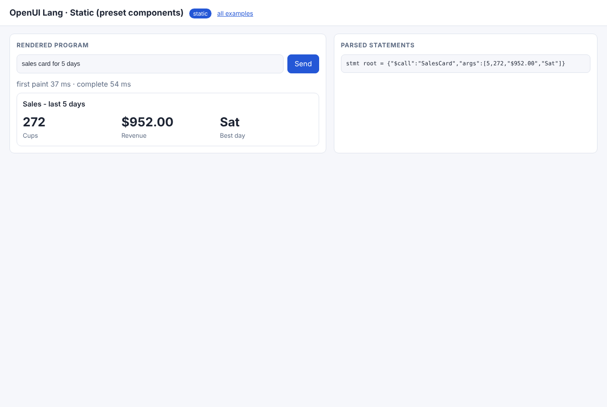
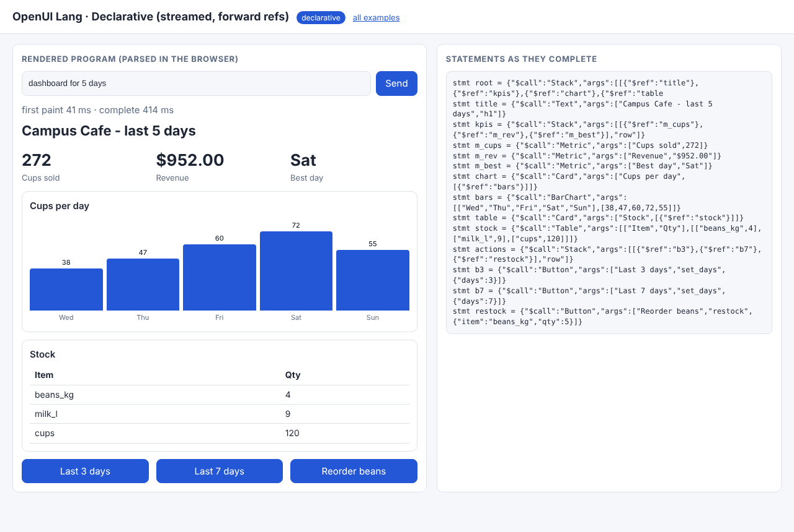
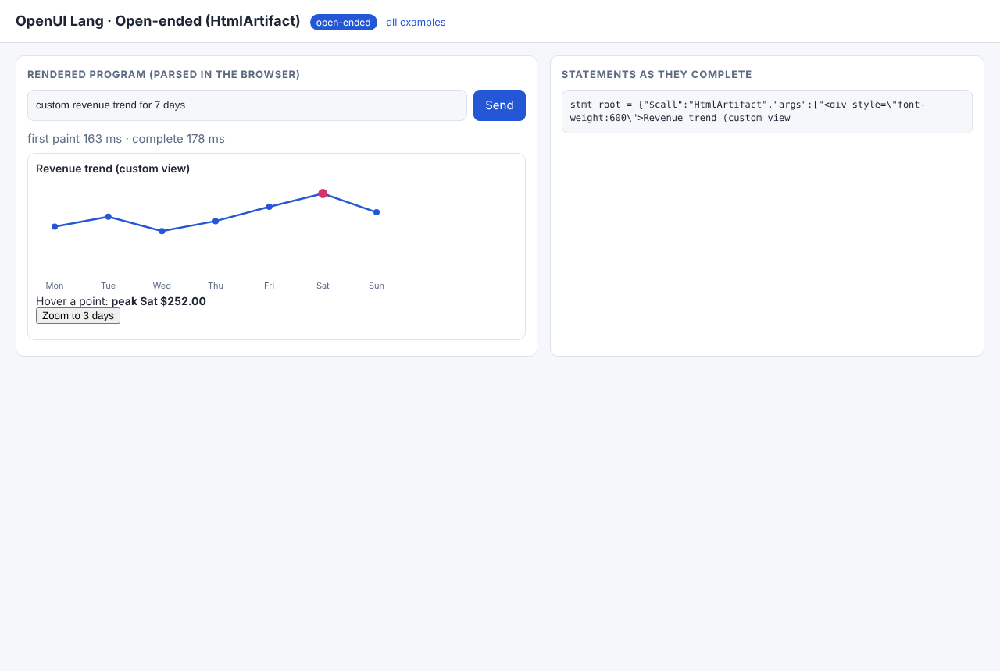
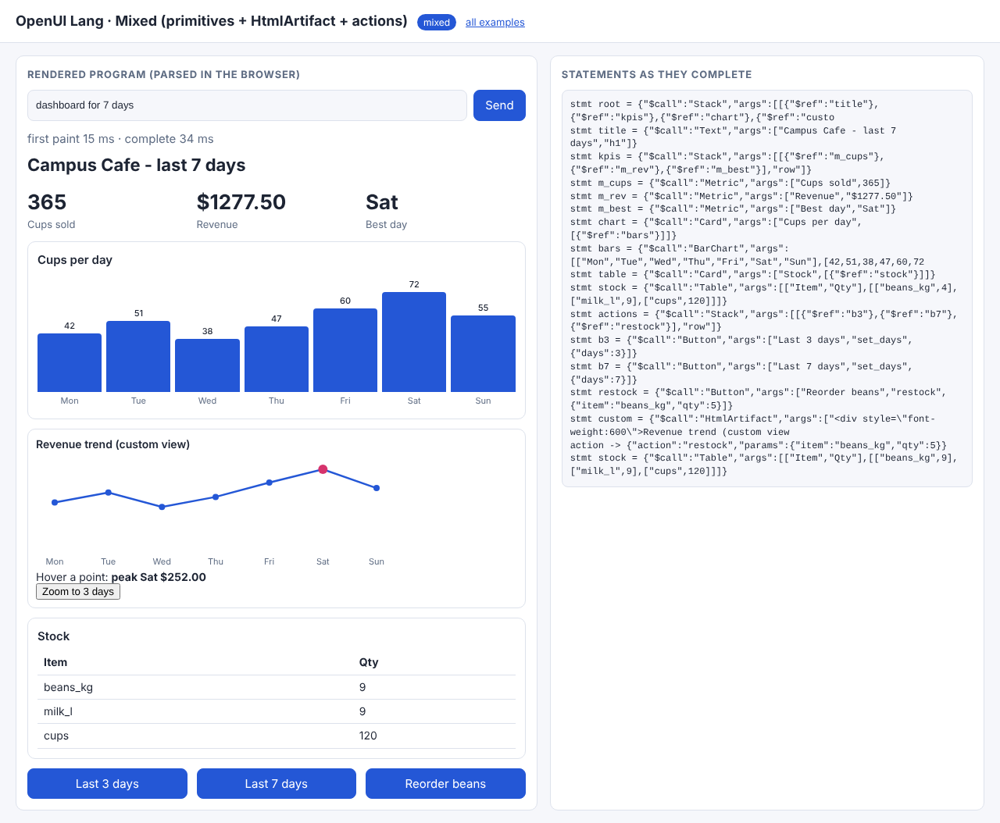

# 05 · OpenUI Lang: a compact language for the same UI

Modeled on [thesys OpenUI](https://github.com/thesysdev/openui)'s `openui-lang`. A program is a list of assignments with
**positional** arguments. `root` comes first, and identifiers may be used **before** they are defined:

```text
root = Stack([title, kpis, chart], "column")
title = Text("Campus Cafe - last 5 days", "h1")
kpis = Stack([m_cups, m_rev], "row")
m_cups = Metric("Cups sold", 272)
...
```

Forward references let the page draw the skeleton from line 1 and fill it in as lines stream. Strings use JSON escaping,
so HTML can travel inside `HtmlArtifact("…")`.

Parsers: [`common/openui.py`](../common/openui.py) (tokenizer → `parse_statement` → `split_statements` → `Program` resolver/validator,
plus `from_spec()`) and the browser mirror [`common/web/openui.js`](../common/web/openui.js). `tests/parity.test.mjs` checks that both produce the same tree.
**Here the browser does the parsing:** the server streams raw program text.

| Mode | Folder | Program |
|---|---|---|
| static | [01_static](01_static/) | one line over a preset catalog: `root = SalesCard(5, 272, "$952.00", "Sat")` |
| declarative | [02_declarative](02_declarative/) | primitives, streamed, forward refs + **format size benchmark** |
| open-ended | [03_open_ended](03_open_ended/) | `root = HtmlArtifact("<escaped html>", 240)` |
| mixed | [04_mixed](04_mixed/) | primitives + `HtmlArtifact` + Buttons; action replies are **re-assignments** |

```bash
python 05_openui/02_declarative/example.py
python serve.py        # http://127.0.0.1:8000/05_openui/02_declarative/
```

## Code walkthrough

### 01 · static
- `PRESET_SIGNATURES` is the whole catalog. `generate()` requires exactly one statement. `index.html` defines the presets.

### 02 · declarative
- `split_statements()` finds newlines outside strings and brackets. That is how a partial stream is cut into complete statements.
- `Program.tree()` resolves `root`. Undefined refs return `None`, which renders as a placeholder (the CLI shows "unresolved refs" falling as statements arrive).
- `benchmark()`: the same 14-element dashboard measured as OpenUI Lang, json-render spec, json-render JSONL and A2UI JSONL.
  The token figures use a stated heuristic (words/numbers/punctuation), not a model tokenizer:

  | format | chars | ~tokens |
  |---|---:|---:|
  | OpenUI Lang | 721 | 316 |
  | json-render spec (JSON) | 1451 | 713 |
  | json-render JSONL patches | 2042 | 1004 |
  | A2UI v0.9 JSONL (incl. data model + buttons) | 2093 | 988 |

### 03 · open-ended
- The escaped HTML alone (about 1.8 K chars) is bigger than the entire declarative program.

### 04 · mixed
- `update()` asks the model for **only the statements that change**. Feeding them to the same `Program` replaces those nodes,
  so updates use the same streaming parser as the first render, with no extra patch format.

Recorded output: [docs/EXECUTION_LOG.md#05_openui](../docs/EXECUTION_LOG.md#05_openui).

| static | declarative | open-ended | mixed (after action) |
|---|---|---|---|
|  |  |  |  |
