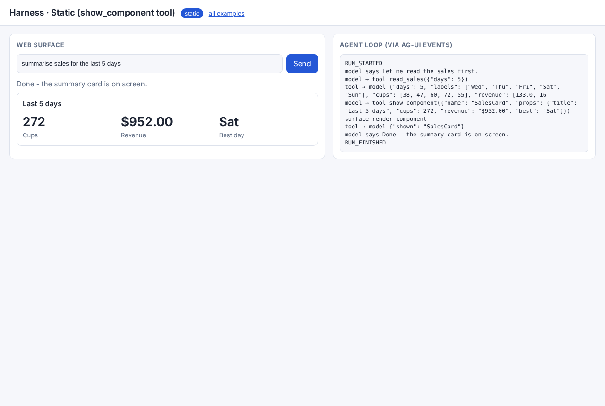
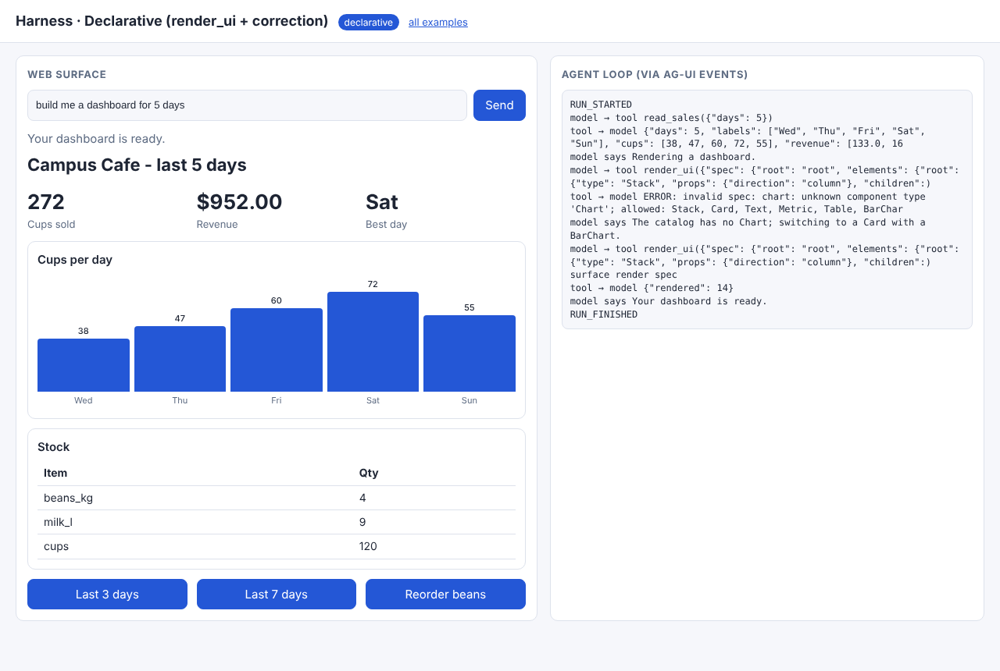
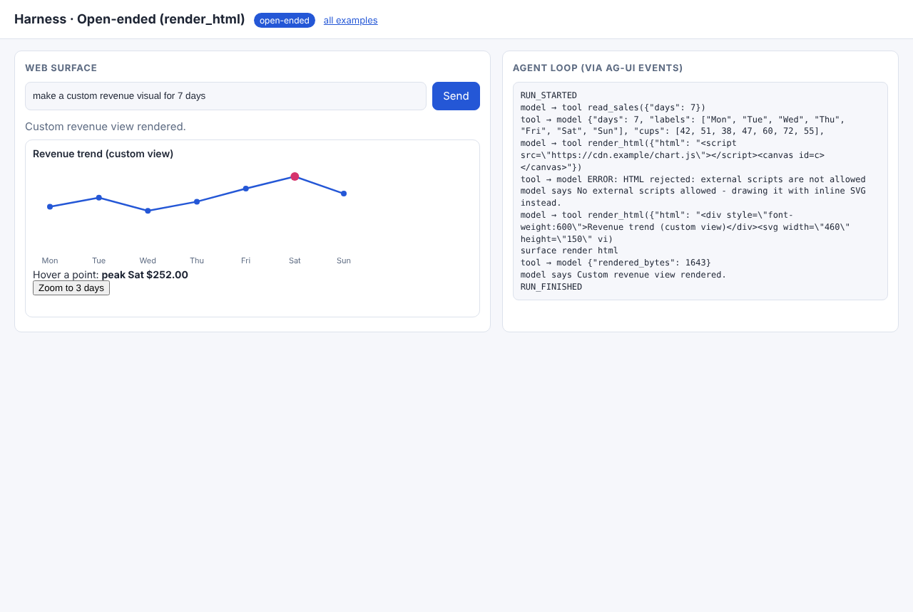
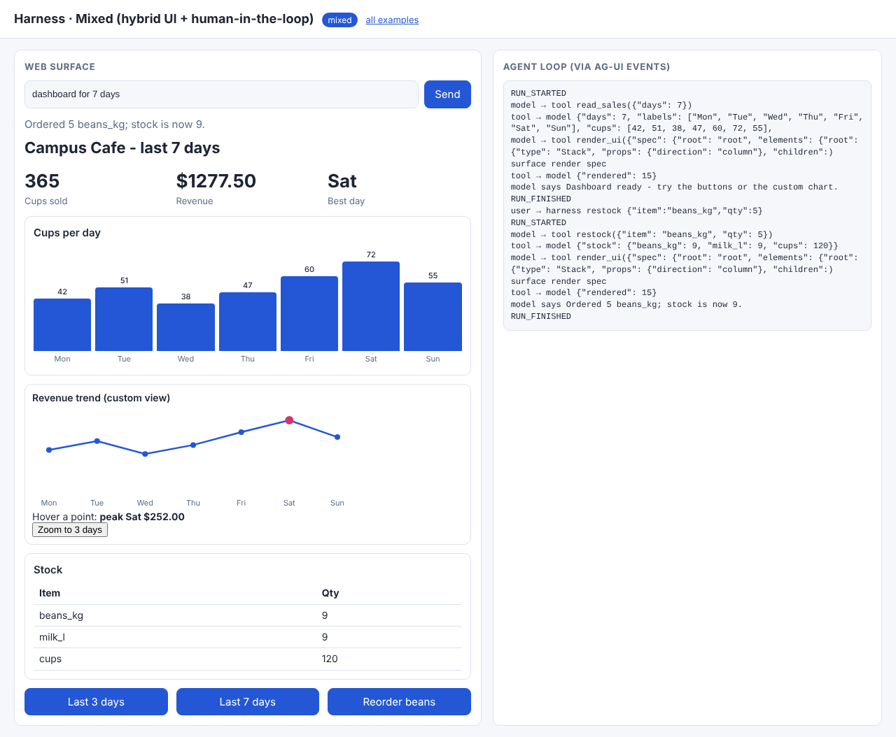

# 06 · Harness integration: UI as a tool in the agent loop

A coding/agent **harness** is the loop `model → tool calls → results → model …`. Generative UI joins it as one more tool.
[`common/harness.py`](../common/harness.py) is a complete harness in about 100 lines:

* `Harness.run()` is the loop. Every callback becomes an **AG-UI event** (`TOOL_CALL_*`, `TEXT_MESSAGE_*`, `CUSTOM "render"`),
  so this theme reuses theme 01 as its transport.
* Tool errors (`ToolError`) are returned to the model as `tool_result` with `is_error: true`. They never crash the loop.
  All results of one step go back in **one** user message.
* Rendering tools return `_render`, which goes to **two surfaces**: the terminal ([`tools.py → terminal_surface`](tools.py)) and the web page ([`page.js`](page.js)).
* Offline, a scripted `policy(messages)` plays the model step by step. With `GENUX_LIVE=1`, `_claude_step()` lets Claude drive
  the same loop with real tool use.

| Mode | Folder | UI tool | What the loop demonstrates |
|---|---|---|---|
| static | [01_static](01_static/) | `show_component(name ∈ enum, props)` | read_sales → show_component → answer |
| declarative | [02_declarative](02_declarative/) | `render_ui(spec)` | invalid spec → `is_error` → model corrects → render |
| open-ended | [03_open_ended](03_open_ended/) | `render_html(html)` | CDN script blocked by policy → model rewrites with inline SVG |
| mixed | [04_mixed](04_mixed/) | `render_ui` (catalog + GeneratedView) + `restock` | UI clicks re-enter the loop as `[ui action] …` user turns |

```bash
python 06_harness/02_declarative/example.py     # loop trace + terminal surface
python serve.py                                 # http://127.0.0.1:8000/06_harness/04_mixed/  (web surface)
```

## Code walkthrough

### 01 · static
- `show_component()` checks the enum and the required props. `TOOLS` maps the names to `(schema, fn)`. The schema is what Claude sees in live mode.
- `policy()` step 0 reads data, step 1 shows a component, step 2 answers. `steps_since_user()` tells the policy where it is.

### 02 · declarative
- `render_ui()` raises `ToolError("invalid spec: …")`. In the trace the `TOOL_CALL_RESULT` begins with `ERROR:`, and the next step
  says "The catalog has no Chart…" and sends a valid spec. This is self-correction through tool results.

### 03 · open-ended
- `render_html()` enforces `check_html()`. The web surface mounts the HTML sandboxed. The terminal surface prints a placeholder.
  Clicking "Zoom to 3 days" in the iframe starts a fresh agent run.

### 04 · mixed
- `SESSIONS` keeps one `Harness` (its whole message history) per thread. `on_action()` allow-lists the action, then calls
  `run("[ui action] restock {...}")` on the **same** conversation. The model calls the side-effect tool `restock` and re-renders.

Recorded output: [docs/EXECUTION_LOG.md#06_harness](../docs/EXECUTION_LOG.md#06_harness).

| static | declarative | open-ended | mixed (after action) |
|---|---|---|---|
|  |  |  |  |
