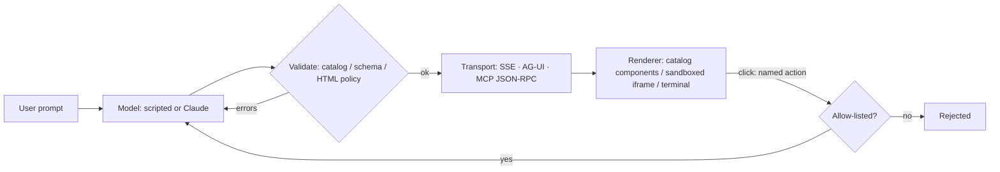

> **Assignment 5 (RSI, Section 10 Research Studio)** is in [`assignment5_rsi/`](assignment5_rsi/):
> *SignalForge*, a self-improving traffic-signal controller. It contains all 17 Section-10 codelabs plus a synthesis lab,
> and compares three October 2026 RSI methods (Budget RSI, SO-RSI, SwarmRSI) head to head.
> Website: [`assignment5_rsi/docs/index.html`](assignment5_rsi/docs/index.html) · execution log:
> [`assignment5_rsi/docs/EXECUTION_LOG.md`](assignment5_rsi/docs/EXECUTION_LOG.md).
> The Assignment 4 (GenUX) material below is unchanged.

# GenUX: A2UI · AG-UI · MCP Apps · json-render · OpenUI · Harness integration

**Assignment 4 (GenUX)**: runnable examples of six generative-UI technologies, each in all four generation modes
(**static, declarative, open-ended, mixed**), with code walkthroughs and recorded execution. That makes **24 examples**,
all using the same small "Campus Cafe" sales dataset, so the only thing that changes between examples is the technology and the mode.

* **Runs offline, no install:** Python 3.10+ standard library + vanilla browser JavaScript. A scripted model makes every run deterministic.
* **Optional live mode:** `pip install anthropic`, `export ANTHROPIC_API_KEY=…`, `export GENUX_LIVE=1`. The same prompts go to Claude
  (`claude-opus-5-5`, override with `GENUX_MODEL`), and the output goes through exactly the same validators.
* **Proof of execution:** [docs/EXECUTION_LOG.md](docs/EXECUTION_LOG.md) (unedited terminal output of all 24 examples + tests) and
  [docs/screenshots/](docs/screenshots/) (all 24 pages in Chromium, plus "after click" captures for each mixed mode).

Reference used: [dlmastery/simple-coding-harness/genui](https://github.com/dlmastery/simple-coding-harness/tree/main/genui).
The code here is an independent, smaller implementation built for step-by-step explanation.

## Quick start

```bash
python run_all.py            # run all 24 terminal walkthroughs + the test suite, rewrite docs/EXECUTION_LOG.md
```

```bash
python serve.py              # open http://127.0.0.1:8000/  (index of every example)
```

```bash
python 02_a2ui/02_declarative/example.py      # any single example's terminal walkthrough
```

```bash
python -m unittest discover -s tests -v       # 22 tests (includes a Node check that browser and Python parsers agree)
```

```bash
node scripts/screenshots.mjs                  # with serve.py running: re-capture every page and click the mixed-mode buttons
```

## The two decisions behind every example

**1. What may the model generate? (the mode)**

| Mode | The model… | Safety boundary | Cost |
|---|---|---|---|
| **static** | picks a prebuilt component and fills values | your component code | lowest |
| **declarative** | composes components from a **catalog** | validator against the catalog | low; streams well as a flat element map |
| **open-ended** | writes HTML/JS | server content policy + sandboxed iframe (opaque origin, CSP `default-src 'none'`, one postMessage shape) | highest bytes, least portable |
| **mixed** | uses the catalog everywhere it can + **one** sandboxed custom region; user actions round-trip to the agent | both of the above + action allow-list | usually the best default |

**2. How does the UI travel? (the technology)**: these are different layers, not interchangeable names:

| Technology | Layer | Folder |
|---|---|---|
| **AG-UI** | transport: typed agent→page events (tool calls, shared state, custom) | [01_ag_ui](01_ag_ui/) |
| **A2UI** | format: surface + component list + separate data model, catalog-gated | [02_a2ui](02_a2ui/) |
| **MCP Apps** | host integration: a tool result carries a `ui://` resource that a host mounts and bridges | [03_mcp_apps](03_mcp_apps/) |
| **json-render** | format + renderer: flat spec, catalog of components **and** actions, streamed JSON patches, multiple targets | [04_json_render](04_json_render/) |
| **OpenUI Lang** | format: compact positional language with forward references, parsed while streaming | [05_openui](05_openui/) |
| **Harness integration** | the agent loop: UI as a tool, errors as results, terminal + web surfaces (over AG-UI) | [06_harness](06_harness/) |



## All 24 examples

| # | Technology | static | declarative | open-ended | mixed |
|--:|---|---|---|---|---|
| 1 | AG-UI | [tool call → prebuilt component](01_ag_ui/01_static/example.py) | [STATE_SNAPSHOT + STATE_DELTA](01_ag_ui/02_declarative/example.py) | [HTML as tool args → sandbox](01_ag_ui/03_open_ended/example.py) | [GeneratedView + actions as new runs](01_ag_ui/04_mixed/example.py) |
| 2 | A2UI | [fixed template, model fills data](02_a2ui/01_static/example.py) | [model writes messages, self-corrects](02_a2ui/02_declarative/example.py) | [opt-in `HtmlFrame` catalog](02_a2ui/03_open_ended/example.py) | [actions → `updateDataModel` only](02_a2ui/04_mixed/example.py) |
| 3 | MCP Apps | [hand-written `ui://` view](03_mcp_apps/01_static/server.py) | [generic catalog-renderer view](03_mcp_apps/02_declarative/server.py) | [nested sandbox](03_mcp_apps/03_open_ended/server.py) | [app-only tool + nested region](03_mcp_apps/04_mixed/server.py) |
| 4 | json-render | [preset-only catalog](04_json_render/01_static/example.py) | [JSONL patch stream, line validation](04_json_render/02_declarative/example.py) | [GeneratedView, terminal can't render](04_json_render/03_open_ended/example.py) | [typed actions, two renderers](04_json_render/04_mixed/example.py) |
| 5 | OpenUI Lang | [one-line preset program](05_openui/01_static/example.py) | [forward refs + format benchmark](05_openui/02_declarative/example.py) | [`HtmlArtifact`](05_openui/03_open_ended/example.py) | [updates as re-assignments](05_openui/04_mixed/example.py) |
| 6 | Harness | [`show_component` tool](06_harness/01_static/example.py) | [`render_ui` + correction via is_error](06_harness/02_declarative/example.py) | [`render_html` + policy retry](06_harness/03_open_ended/example.py) | [UI clicks re-enter the loop](06_harness/04_mixed/example.py) |

Each technology folder has a README with a mode-by-mode code walkthrough and screenshots. Suggested order: **01 → 06**, and
inside each folder **static → declarative → open-ended → mixed**. Each step adds exactly one idea to the previous one.

## Repository layout

```text
serve.py              one local server for all 24 pages (GET page, POST /<tech>/<mode>/api/<route> -> JSON or SSE)
run_all.py            run every example + tests, write docs/EXECUTION_LOG.md
common/
  data.py fixtures.py   the Campus Cafe data and the scripted model replies
  llm.py                scripted model / Claude (GENUX_LIVE=1)
  catalog.py            the component catalog: prompt text + validator
  sandbox.py            server-side content policy for generated HTML
  jsonpatch.py          RFC 6902 subset
  agui.py a2ui.py mcp.py mcp_host.py jsonrender.py openui.py harness.py   one module per technology
  web/                  catalog.js (renderer) sandbox.js sse.js jsonpatch.js a2ui.js openui.js mcp_host.js mcp_view_bridge.js style.css
NN_tech/NN_mode/      example.py (agent/server logic + `cli()` walkthrough) and index.html (browser client)
tests/                unittest suite + Node parity test
scripts/screenshots.mjs  Playwright capture of all pages (+ clicks in mixed mode)
docs/                 EXECUTION_LOG.md, screenshots/
```

Every `example.py` exposes the same four names: `TITLE`, `MODE`, `ROUTES` (what `serve.py` mounts) and `cli()` (the terminal walkthrough).

## YouTube walkthroughs

| Part | Video |
|---|---|
| 1 · AG-UI | _add link_ |
| 2 · A2UI | _add link_ |
| 3 · MCP Apps | _add link_ |
| 4 · json-render | _add link_ |
| 5 · OpenUI Lang | _add link_ |
| 6 · Harness integration | _add link_ |

## Honest limits

* A2UI, AG-UI, MCP Apps, json-render and OpenUI Lang are **reimplemented minimally** from their public specs to show the mechanics. Production code
  should use the official SDKs (`@ag-ui/client`, `@a2ui/lit`, `@modelcontextprotocol/ext-apps` / `mcp`, `@json-render/core`, `@openuidev/react-lang`).
* The scripted model replays what a model would output, including deliberate mistakes that exercise the correction paths. Live mode was not run for
  the recorded log (no API key in the recording environment).
* Token counts in the OpenUI benchmark use a stated heuristic, not a model tokenizer.
* Action endpoints keep in-memory state (stock), so restart `serve.py` to reset it.
