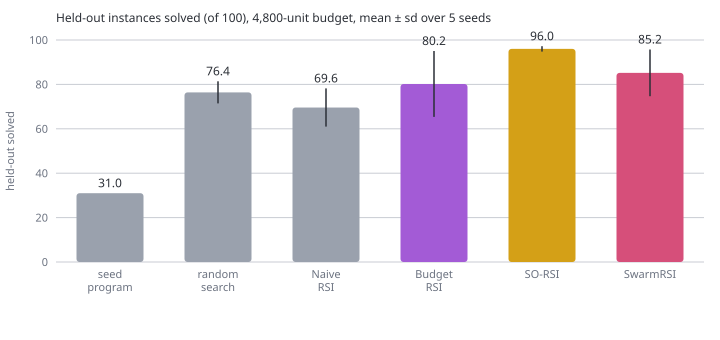
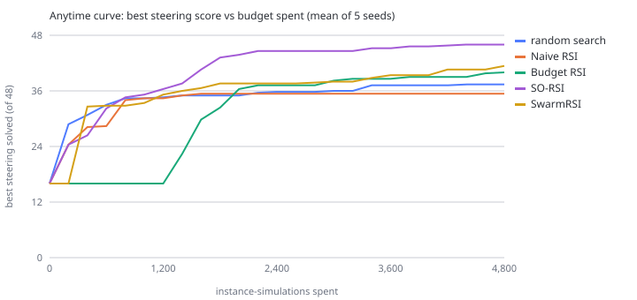

# Assignment 5: RSI Research Studio on *SignalForge*

**Three October 2026 recursive-self-improvement methods, rebuilt and compared on one problem:
a self-improving traffic-signal controller.**

This folder implements every codelab of **Section 10 ("Read and Rebuild October 2026 Research", labs 10.01–10.17)** of the
[RSI Masterclass course map](https://github.com/dlmastery/simple-coding-harness/blob/main/COURSE-MAP.md#theme-10) in order, plus a
synthesis lab (10.18) that puts the three headline methods head to head under one fair protocol.

| | |
|---|---|
| **Problem area** | Traffic-signal control: an RSI system rewrites the Python program that runs a four-way intersection |
| **Three SOTA RSI methods** | **Budget RSI** (arXiv:2610.29121) · **SO-RSI** (arXiv:2610.05701) · **SwarmRSI** (arXiv:2610.20431) |
| **Also implemented** (labs 10.10, 10.13, 10.14) | AReaL-RSI (2610.18083) · RSIFlow (2610.21791) · Self-HPO (2610.22791) · RSIGym's RSI-Index and EaaS (2610.10310) |
| **Runs on** | Python 3.10+ standard library only, CPU only. Fully deterministic (seeded). No API keys. |
| **Proof of execution** | [`docs/EXECUTION_LOG.md`](docs/EXECUTION_LOG.md): unedited stdout of all 18 labs + 17 unit tests |
| **Website** | [`docs/index.html`](docs/index.html): results page generated from `docs/results/*.json` |
| **Videos** | *To be recorded* (one per part; links will be added in the table at the bottom) |

```bash
cd assignment5_rsi
python run_all.py                          # every lab in order + tests -> docs/EXECUTION_LOG.md + docs/index.html (~10 min)
```

```bash
python labs/10_06_run_so_rsi/lab.py        # any single lab
```

```bash
RSI_FAST=1 python run_all.py               # smoke run: 2 seeds per experiment
```

```bash
python -m unittest discover -s tests -v    # 17 tests
```

---

## 1. Why traffic signals (the unique problem area)

The RSI papers in the course improve coding agents, theorem provers and kernels. Their ideas need a setting where:

* the **improved object is code**, so diffs, mechanisms and constants all exist;
* evaluation is **cheap enough** (~1 ms per instance) to run many seeds and ablations on a laptop;
* there are **real trade-offs**, so first-order patching thrashes. In a signal controller, longer greens cut lost time but
  starve the cross street; a gap-out detector helps at night and hurts at rush hour; a new mechanism with a bad
  constant makes things *worse*;
* there is a natural **held-out** set (unseen traffic days) and natural **families** (rush hour, stadium surge, night...).

### The environment: [`signalforge/`](signalforge/)

| File | What it is |
|---|---|
| [`sim.py`](signalforge/sim.py) | 1-second intersection simulator: 4 approaches, 2 phases, 2 s saturation headway, 2 s start-up loss, 4 s clearance. An instance is **solved** if average delay ≤ 18 s **and** no car waits > 70 s. |
| [`scenarios.py`](signalforge/scenarios.py) | 8 traffic families × seeds. Splits **fit 16 / steering 48 / held-out 100**, stratified and disjoint. They mirror Budget RSI's fit/steering/held-out protocol. |
| [`program.py`](signalforge/program.py) | The improved object. A genome (5 mechanisms + 6 constants) that is **always rendered to real Python source** and `exec`-compiled. Edit operators are `add/remove <mechanism>` and `increase/decrease <constant>`. |
| [`diff_features.py`](signalforge/diff_features.py) | Budget RSI's 8 static diff coordinates (lines ±, functions ±, branches, switch paths, constants changed, signed log change), plus 19 task-specific ones for lab 10.05. |
| [`evaluator.py`](signalforge/evaluator.py) | Budgeted evaluator + cost ledger. **Search code cannot read held-out data**: it is not reachable from `SearchEvaluator`, and every `final_report` call is logged. A unit test runs every method and asserts the log did not grow. |
| [`methods/`](signalforge/methods/) | `budget_rsi.py`, `so_rsi.py`, `swarm_rsi.py` (headline methods) · `areal_rsi.py`, `rsiflow.py`, `self_hpo.py` · `baselines.py` (random search, Naive RSI) |
| [`metrics.py`](signalforge/metrics.py) · [`services.py`](signalforge/services.py) | RSI-Index, steering-proxy validity, Recursive Learnability, swarm diversity · RSIGym-style service facade with budget + permissions + sandbox |
| `stats.py`, `svg.py`, `labkit.py` | Ridge regression / Spearman in pure Python, hand-written SVG charts, lab helpers |

The seed program is a plain fixed-time plan (30 s green each way) and solves **31/100** held-out instances. Every
mechanism ships with poor, conservative default constants (gap-out 6 s, max-green 90 s, pressure ratio 4.0,
starvation limit 120 s). So adding a mechanism *alone* often hurts, and progress needs coordinated
structure + constant changes. That is exactly where the three methods differ.

---

## 2. The three RSI methods

### Budget RSI: score edits before running them ([`methods/budget_rsi.py`](signalforge/methods/budget_rsi.py), labs 10.03–10.05)
1. Collect **96 scaffold edits**, each child labelled on the 16-instance *fit* split.
2. Fit a **linear readout** `score = w · [1, parent_rate, 8 diff coordinates]` (ridge, stdlib).
3. **Huxley–Gödel Machine search**: Thompson-sample a parent on its steering counts, propose 8 children, score them *from
   their diffs alone*, and expand only the top one. Return the earliest node with maximal steering count.
4. **Recursive step (10.05):** `online_refit=True` turns every expansion into a new training row and refits the readout, so
   the improver revises its own selection rule during the run.

### SO-RSI: diagnose before patching ([`methods/so_rsi.py`](signalforge/methods/so_rsi.py), labs 10.06–10.08)
Naive RSI's propose → evaluate → keep-if-better loop, plus an inquiry layer:
* **anomaly detection** on its own edit trace: *recurrence* (the same operator keeps failing), *opposing* (X up, then X down, both
  failing), *mismatch* (outcome contradicts the running expectation of that operator);
* **diagnostic probes**: small real experiments only on the instances the incumbent fails, plus a regression sample.
  `mechanism_probe` sweeps a new mechanism's constant, `direction_probe` sweeps a stuck constant, and `structure_probe`
  attributes failures (wait vs delay, light vs heavy) and tests the mechanisms that address them. **Probes are charged to the budget.**
* **inquiry memory**: tuned constants (reused whenever that mechanism is added again), exhausted operators, refuted
  recommendations, and the causal findings log. Memory persists across RSI rounds (lab 10.07 §3).

### SwarmRSI: an evolving swarm of research agents ([`methods/swarm_rsi.py`](signalforge/methods/swarm_rsi.py), lab 10.11)
* 5 agents with different **research directions** (fairness, responsive, pressure, timing, explorer): different starting
  mechanisms and operator preferences.
* **Feedback-guided mutation**: operator choice = own preference × what the shared experience board says it did for others.
  Success reinforces the agent's hypothesis; failure weakens it.
* **Complementary recombination**: pair the agents whose per-family solve vectors complement each other most. The child takes each
  mechanism from the parent stronger on the families that mechanism serves, and replaces the weakest agent.
* **Recursive swarm evolution**: the swarm measures gain per unit for mutation vs recombination, and evolves its own
  recombination interval and mutation step size.

---

## 3. Results: lab 10.18, same total budget for everyone, held-out read only after search

Held-out instances solved (of 100), mean ± sd over 5 seeds. The seed program solves 31.

| method | 2,400 units | 4,800 units | RSI-Index @4,800 | budget actually used @4,800 |
|---|---|---|---|---|
| random search | 69.2 ± 6.1 | 76.4 ± 5.0 | 0.68 | 4,800 |
| Naive RSI (first-order) | 69.6 ± 8.6 | 69.6 ± 8.6 | 0.60 | 1,757 (stuck in a local optimum) |
| **Budget RSI** | 76.0 ± 7.2 | 80.2 ± 14.8 | 0.74 | 4,784 (1,328 on readout labels) |
| **SO-RSI** | **92.2 ± 9.1** | **96.0 ± 1.2** | **0.95** | 3,387 (1,156 on probes; converged) |
| **SwarmRSI** | 75.8 ± 8.6 | 85.2 ± 10.5 | 0.80 | 4,800 |




### What the evidence supports (and what it does not)
* **SO-RSI's advantage survives every control we ran.** Removing the hand-written mechanism map barely changes it (93.2 vs 93.4,
  lab 10.07), so the gain comes from *anomaly-gated sweeps on failing instances*, not from domain knowledge. Probing after
  every failure instead of on anomalies costs ~10 instances, and switching the inquiry layer off gives Naive RSI's 68.9.
* **Budget RSI is only as good as its training edits.** Trained on random-walk parents (a distribution shift), the readout ranks the
  strong parents HGM actually expands worse, and loses ~12 held-out instances (lab 10.04). Its gain over the parent-rate
  ablation (+2.9) is small and noisy, much like the paper's 87.0 vs 84.2. Task-specific features *plus* online refit (the
  recursive variant) gave the best Budget RSI result (81.8, lab 10.05).
* **SwarmRSI's result comes from diverse research directions.** Removing the board, recombination or procedure evolution is within
  noise at this budget. Giving every agent the same start costs ~7 instances (lab 10.11).
* **Negative results, reported as measured:** the RSIFlow meta-agent ties a static workflow (76.4 vs 76.4 over 12 seeds, lab 10.13).
  Self-HPO's joint gain equals the sum of its parts (additive, not synergistic, lab 10.14).
* **Scope:** these are laptop adaptations. They preserve each paper's *mechanism*, not its scale, its models or its headline numbers
  (lab 10.02 audits exactly that).

---

## 4. The codelabs (each folder: `lab.py` + `README.md` walkthrough)

| Course lab | Folder | What runs |
|---|---|---|
| 10.01 Distinguish claim from evidence | [`labs/10_01_claim_vs_evidence`](labs/10_01_claim_vs_evidence/) | re-runs the course SO-RSI demo's logic with diagnostics deleted; one seed vs 10 seeds; selection effect |
| 10.02 Audit an October 2026 paper | [`labs/10_02_audit_paper`](labs/10_02_audit_paper/) | SO-RSI audit table; measures the "probes are lightweight" assumption |
| 10.03 Run the Budget RSI demo | [`labs/10_03_run_budget_rsi`](labs/10_03_run_budget_rsi/) | scaffold edits → readout → one HGM step in slow motion → 40-expansion comparison → cost |
| 10.04 Analyse the scoring mechanism | [`labs/10_04_analyze_readout`](labs/10_04_analyze_readout/) | feature importance, within-sibling validity, 8→4 features, 96→24 edits, distribution shift |
| 10.05 Extend to your own edits | [`labs/10_05_extend_readout`](labs/10_05_extend_readout/) | task-specific features, online refit (recursive), shuffled-label negative control |
| 10.06 Run the SO-RSI demo | [`labs/10_06_run_so_rsi`](labs/10_06_run_so_rsi/) | narrated trace + findings; passive detector on Naive RSI; 8 seeds |
| 10.07 Analyse diagnostic probes | [`labs/10_07_analyze_probes`](labs/10_07_analyze_probes/) | anomaly/probe statistics; mechanism-map and gating ablations; memory across rounds |
| 10.08 Apply to a debugging task | [`labs/10_08_apply_debugging`](labs/10_08_apply_debugging/) | a real failing test in this simulator; thrash trace; root-cause probe (the test is wrong) |
| 10.09 Compare scaling approaches | [`labs/10_09_compare_scaling`](labs/10_09_compare_scaling/) | AReaL-RSI vs SwarmRSI vs single agent, completed comparison table |
| 10.10 Simulate leader-follower | [`labs/10_10_leader_follower`](labs/10_10_leader_follower/) | 1 leader + 2 specialists, conditional memory; shared vs independent |
| 10.11 Simulate swarm evolution | [`labs/10_11_swarm_evolution`](labs/10_11_swarm_evolution/) | 5-agent swarm narrated; 4 ablations |
| 10.12 Compare workflow adaptation | [`labs/10_12_compare_workflows`](labs/10_12_compare_workflows/) | RSIFlow vs Self-HPO vs Naive RSI |
| 10.13 Simulate RSIFlow meta-agent | [`labs/10_13_rsiflow_meta_agent`](labs/10_13_rsiflow_meta_agent/) | 5-route workflow graph, discounted UCB routing, self-rewriting screen; adaptive vs static |
| 10.14 Simulate Self-HPO alternation | [`labs/10_14_self_hpo`](labs/10_14_self_hpo/) | H-steps / P-steps with failure curricula; policy-only vs harness-only vs joint |
| 10.15 Calculate RSI-Index | [`labs/10_15_rsi_index`](labs/10_15_rsi_index/) | course example, 5-benchmark task, 8 traffic families × 3 methods |
| 10.16 Compare environments | [`labs/10_16_environments`](labs/10_16_environments/) | SignalForge as EaaS with budget/permission/sandbox; RSIGym vs Terminal-RSI vs R2Orch |
| 10.17 Analyse metrics | [`labs/10_17_metrics`](labs/10_17_metrics/) | steering-proxy validity, Recursive Learnability per family, swarm diversity |
| 10.18 *(synthesis)* | [`labs/10_18_three_method_showdown`](labs/10_18_three_method_showdown/) | the three methods + 2 baselines × 2 budgets × 5 seeds; figures |

## 5. Notes on the source material
* The assignment links `rsi/COURSE-MAP.md`. That path now returns 404; the course map lives at the repository root
  ([`COURSE-MAP.md`](https://github.com/dlmastery/simple-coding-harness/blob/main/COURSE-MAP.md)), and Section 10 is unchanged there.
* The paper descriptions follow the course's [`12_october_2026_papers/PAPER_SUMMARIES.md`](https://github.com/dlmastery/simple-coding-harness/blob/main/12_october_2026_papers/PAPER_SUMMARIES.md).
  All code here is an independent implementation. The course's reference demos were read, not copied.
* Two issues found in the course material and handled in the labs: the reference SO-RSI demo hard-codes its success rates
  (lab 10.01), and the RSI-Index formula on the lab 10.15 page has its numerator sign flipped relative to its own worked example (lab 10.15).
* AI coding assistance was used to write this code. Every number in the READMEs and on the website comes from the logged runs.

## 6. Video walkthroughs

| Part | Labs | Link |
|---|---|---|
| Problem + SignalForge code tour | README, `signalforge/` | *to be recorded* |
| Reading frontier claims | 10.01–10.02 | *to be recorded* |
| Method 1: Budget RSI | 10.03–10.05 | *to be recorded* |
| Method 2: SO-RSI | 10.06–10.08 | *to be recorded* |
| Scaling: AReaL-RSI + Method 3: SwarmRSI | 10.09–10.11 | *to be recorded* |
| Adaptive workflows: RSIFlow + Self-HPO | 10.12–10.14 | *to be recorded* |
| Environments & metrics | 10.15–10.17 | *to be recorded* |
| Head to head + conclusions | 10.18 | *to be recorded* |
