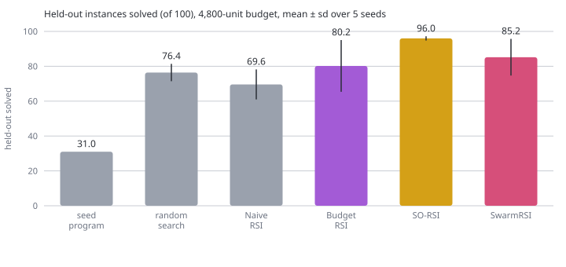
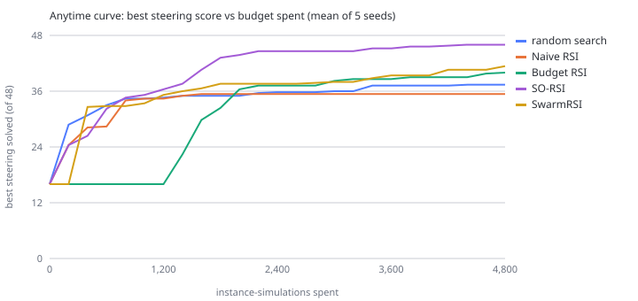

# 10.18 · Synthesis: three RSI methods head to head

Not a course lab: the synthesis the assignment asks for. It compares three state-of-the-art RSI methods on our problem under one protocol.
Run: `python labs/10_18_three_method_showdown/lab.py` (~105 s). Figures: [`docs/figures/`](../../docs/figures/).

## Protocol (held fixed for every method)
* same seed program (31/100 held-out), edit operators, simulator and 48-instance steering split;
* the same **total** budget of instance-simulations. Budget RSI's 96 readout labels and SO-RSI's probes are charged to it;
* held-out (100 instances) read once per run, after search returns. A unit test asserts that no method ever reads it;
* 5 seeds × 2 budgets (2,400 and 4,800), against two baselines (random search and Naive RSI).

## Results
| method | held-out @2,400 | held-out @4,800 | RSI-Index @4,800 | where the budget went @4,800 |
|---|---|---|---|---|
| random search | 69.2 ± 6.1 | 76.4 ± 5.0 | 0.68 | 4,800 search |
| Naive RSI | 69.6 ± 8.6 | 69.6 ± 8.6 | 0.60 | 1,757: stalls in a local optimum |
| **Budget RSI** | 76.0 ± 7.2 | 80.2 ± 14.8 | 0.74 | 1,328 readout labels + 3,456 expansions |
| **SO-RSI** | **92.2 ± 9.1** | **96.0 ± 1.2** | **0.95** | 2,231 search + 1,156 probes; converged |
| **SwarmRSI** | 75.8 ± 8.6 | 85.2 ± 10.5 | 0.80 | 4,714 mutation + 86 recombination |

## How each improver revised itself (seed 0, from the log)
* **Budget RSI** learns a selection rule before searching. Its strongest diff coordinates are branch_delta −0.36, funcs_added +0.19 and
  consts_changed −0.18. Its anytime curve is flat until the labels are paid for, then climbs steeply.
* **SO-RSI** ends with 135 findings, tuned constants `{max_cap: MAX_GREEN 60, pressure: RATIO 5.0}`, 9 exhausted operators and 9 refuted recommendations.
* **SwarmRSI** evolves its procedure to "recombine every 6 cycles, mutation step ≤ 2", keeping 5 distinct lineages.

## Conclusions
1. **SO-RSI wins clearly and robustly** (96.0 ± 1.2 at 4,800). Its probes cost ~25–35% of the budget but find coordinated structure + constant
   changes that no single first-order edit rewards. 10.07 shows the gain comes from anomaly-gated sweeps, not from domain knowledge.
2. **SwarmRSI** benefits most from extra budget (+9.4 from 2,400 to 4,800). Its diverse starting hypotheses keep exploring (10.11).
3. **Budget RSI** beats both baselines, but its variance is the largest (62–97). It is only as good as the match between its training edits and the
   search regime (10.04), and the label cost delays its start.
4. **Naive RSI** gets stuck in a local optimum: extra budget buys it nothing. That is the thrashing all three methods are designed to escape.

**Limits.** One intersection model, 8 traffic families, operators instead of an LLM, 5 seeds per cell. These results show that each *mechanism* works
(or does not) under a fair protocol. They do not reproduce the papers' benchmarks or headline numbers.
